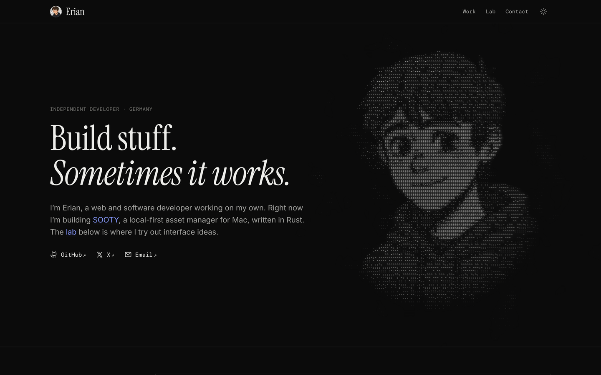

# eooo.me

Erian 的个人网站：首屏是字符拼的头像，下面是正在做的 SOOTY、别的项目、一组能直接玩的界面小实验和联系方式。网站上的字是英文的，代码注释和文档用中文。



## 本地开发

要 Node 22.23.4 以上（Astro 7 的要求，CI 用的是 24）和 pnpm。

```bash
pnpm install
pnpm dev        # http://localhost:4321
pnpm build      # 生成 dist/
pnpm preview    # 看 dist/ 的样子
pnpm check      # 类型检查
```

改完用浏览器在 1440 和 390 两种宽度、浅色深色各看一遍：不能有横向滚动条，控制台不能有报错。

## 目录

| 位置 | 是什么 |
|---|---|
| `src/pages/` | 页面，一个文件一页：首页 `index.astro`、实验详情 `lab/[slug].astro`、`404.astro` |
| `src/layouts/Base.astro` | 每页共用的外壳：`<head>`（标题、描述、分享卡片）、顶栏、页脚 |
| `src/components/` | 顶栏 `Nav`、页脚 `Footer`、首屏 `Hero`，首页的几节（`Sooty`、`Projects`、`Labs`、`Contact`）和它们用的小组件 |
| `src/site.ts` | 名字、简介、邮箱、GitHub 和 X 的地址，改一处到处跟着变 |
| `src/content/projects/` | 「Projects」里的项目，一个一个 `.md`，字段见 `src/content.config.ts` |
| `src/labs/<slug>/` | 一个实验一个目录：`index.md` 是标题、标签和做法说明，`Demo.tsx` 是组件，样式和图片也放这里 |
| `src/labs/_kit/` | 实验共用的样子（`kit.css`）和图标（`icons.tsx`），见「实验的样子」 |
| `src/islands/LabDemo.tsx` | 页面上唯一的 React 入口，把实验挂到舞台上 |
| `src/scripts/ascii.ts` | 首屏的字符画 |
| `tools/portrait.py` | 从头像插画生成字符画用的图、小头像和 favicon（见「字符画」） |
| `src/styles/global.css` | 配色、字体、几个到处用的类；各组件的样式写在组件自己的 `<style>` 里 |
| `src/assets/` | 头像（`avatar.webp` 顶栏和项目列表用，`portrait.webp` 字符画用）、项目图标这些要经过 Astro 压缩的图 |
| `public/` | 原样发布的文件：字体、favicon、分享卡片 `og.png`、`CNAME` |

## 加一个实验

1. 建目录 `src/labs/<slug>/`，`slug` 就是网址里那段（`/lab/<slug>/`），用小写和短横线。
2. 写 `Demo.tsx`，默认导出一个 React 组件。根元素写 `className="lab-root <自己的类名>"`：`lab-root` 让它撑满舞台、内容居中，颜色、圆角、阴影都从它上面的变量取（见下面「实验的样子」）。舞台在卡片上高 280px、详情页上 320 到 480px，底色跟着主题走（浅色是浅灰，深色是深灰）。样式写在同目录的 `style.css`，在 `Demo.tsx` 里 `import "./style.css"`，选择器都挂在自己的类名下面（`.folder-lab .front`），不写裸的 `button`、`p`。图标从 `../_kit/icons` 拿。图片放 `assets/`，引用写 `import cover from "./assets/cover.webp?url"`（带 `?url` 拿到的是地址；不带的话 Astro 给的是一个对象，`` 会变成 `[object Object]`）。
3. 写 `index.md`：

   ```md
   ---
   title: Folder
   summary: 卡片和详情页标题下的一句话
   tags: [CSS, SVG]
   date: 2025-01-08         # 做出来的日子：卡片上显示年月（Jan 2025），详情页显示月份全称
   inspiration: https://…   # 照着谁的设计做的，没有就不写
   wip: true                # 还没做完：卡片上画斜条纹，不挂组件，不生成详情页
   order: 5                 # 越小越靠前
   ---

   正文是详情页上「怎么做的」那几段，用 Markdown。
   ```

卡片上的「源码」链接指向 GitHub 上的 `src/labs/<slug>/`，不用另外填。`index.md` 里的标题、一句话和做法说明照代码实际怎么做的写，改了做法要跟着改。

## 实验的样子

`src/labs/_kit/kit.css` 是实验共用的一套样子，由 `LabDemo.tsx` 引进来；`_kit/icons.tsx` 是实验用的图标。2026-10-27 laken 要把八个实验的样子统一起来，说明了不是改成直角，于是：

- 网站本身是直角、不用阴影；实验是一个个能摸的小组件，留着圆角和很轻的阴影，但只用这几档：圆角 `--lab-r-sm` 8px、`--lab-r-md` 12px、`--lab-r-lg` 16px、`--lab-r-xl` 24px，阴影 `--lab-shadow-1`（贴着）和 `--lab-shadow-2`（浮起来）。
- 颜色都用 `--lab-*` 变量（卡片底 `--lab-surface`、凹下去的 `--lab-sunken`、线 `--lab-line`、字 `--lab-fg` 这些），用 `light-dark()` 跟着网站的浅色深色走，不写死某一种主题的颜色。强调色就是网站的钴蓝 `--lab-accent`，另外只有报错的 `--lab-danger` 和成功的 `--lab-success`。
- 动效曲线用 `--lab-ease`（一般的过渡）和 `--lab-spring`（弹出来，稍微冲过头）。系统开了「减弱动态效果」，`kit.css` 把实验里的过渡和动画都缩到一瞬。
- 鼠标、触屏、键盘都要能玩：悬停才有的效果，触屏上换成点一下；能点的东西用 `button`，或者加上 `role` 和 `tabIndex`。舞台底下一行 `.lab-hint` 告诉人怎么玩，鼠标、触屏玩法不一样就写两句（`.for-mouse`、`.for-touch`），按设备只露一句。按钮用 `.lab-btn`。
- 省：指针移动时不改 React 的状态，位置写进 CSS 变量或者直接写 `transform`；动的只有 `transform`、`opacity`（和 `translate`、`rotate`、`scale` 这几个单独的属性）；一直转的用 CSS 动画，暂停用 `animation-play-state`；`backdrop-filter` 这种贵的层只在用的时候挂上。
- 不用动画库和图标库：原来几个实验的 Motion 动画换成了 CSS 过渡、`@starting-style` 和 Web Animations，Tabler 图标换成了 Phosphor（跟网站一样），这样实验只下载 React 和自己那一小段。要加图标，从 `@phosphor-icons/core` 的 `assets/regular/` 里把 `<path>` 的 `d` 拷进 `icons.tsx`。

## 加一个项目

在 `src/content/projects/` 加一个 `.md`，只要 frontmatter：`name`、`summary`（一行）、`kind`（App、Tool、Site 这种）、`status`（可不写）、`url`、`icon`（`src/assets/` 里的图，写相对路径）、`order`、`hidden`（可不写）。

图标要正方形、铺满不留白（四周透明的边裁掉），列表里一律显示成 40px、圆角 27% 的方块，几个图标才一样大。

## 设计约定

- 直角、不用阴影，区块之间用 1px 细线分开。首页每一节左边是等宽小字的节名，宽屏上跟着滚动停在顶上。
- 黑白灰为主，略带暖。强调色只有一个钴蓝，只给链接、当前状态和字符画里被搅动的字：浅色主题 `#2F4BE8`（在底色上对比度 6.0），深色主题 `#8597FF`（7.4）。原来是炭火的橙，2026-10-27 laken 嫌它发黄，换成了蓝。灰的几档都过 4.5。值在 `global.css` 开头，深色写了两处（跟随系统、手动选了深色），改要一起改。
- 大标题 Instrument Serif（第二行斜体），标签、日期、导航这些小字 DM Mono，正文用系统字体。两款都是 SIL OFL 1.1，许可证在 `public/fonts/OFL.txt`，文件是从 sooty 官网拷来的拉丁字母子集。字体都放在本站，不从 Google Fonts 拿。
- 浅色、深色跟随系统，顶栏右边的按钮可以手动换，记在 `localStorage` 的 `theme` 里；`<head>` 最前面那段脚本在页面画出来之前就定好，不闪。
- 页面上只有淡入和短距离的位移（`.rise`），系统开了「减弱动态效果」就不动。一直在动的只有首屏的字符画。

## 字符画

首屏右边的头像是用等宽字符拼出来的，四周有一圈慢慢往上飘的字符的烟。打开页面时头像从乱码里由上往下解出来；之后每一格的字都按自己的节拍在相邻的几档之间跳；鼠标拖过去拖出一串蓝色的乱码，点一下荡开一圈。字带一点光晕和颗粒。

- 头像图：`src/assets/portrait.webp` 是 `tools/portrait.py` 从头像插画（白底、背景满是小怪物的那张）生成的：先抠出人，只留亮度，把线条往外扩几个像素（字符画一格大约是原图 8 个像素，原图的线只有 5、6 个像素宽，不加粗五官就糊没了），再以脸为中心往外渐隐，肩膀和胸口淡进烟里。换头像就重跑一遍：`pip install "rembg[cpu]" scipy pillow numpy`，然后 `python3 tools/portrait.py <插画.png>`，顺带重新生成顶栏的小头像（裁到肩膀）和 favicon（只裁头部、切成圆形，16 像素也认得出脸）。
- 怎么画：`ascii.ts` 照 React Bits 的 GradientASCII 组件（sooty.app 首屏的字符光也是它）的做法，用 WebGL2 着色器分三步画：
  1. 场（一格一个像素，格子高 8px、宽 4.8px）：每格算出该多浓。头像那块按亮度：深色主题上原图越亮越浓，浅色主题反过来，两种主题看到的都是正片；深色把头发、衣服这些暗处提亮一点，跟最黑的线条分得开；浅色把头发、衣服压到一半浓，不然跟描边一样黑，脸上的线就淹在里面了。每格在原图上取 3×4 个点，各自换成浓淡再平均：只取格子中心的话，跟格子差不多粗的线时有时无。四周是三层往上飘的噪声当烟。同时算开场显出来没有、被鼠标搅动了多少。
  2. 光晕（四分之一分辨率）：把字画一遍再横竖模糊，垫在字底下。
  3. 合成：按场里这一格的浓淡挑一档字，从字的图集里取出来；图集带 mipmap，字再小边也是顺的。每格有自己的节拍，每秒 4 次在浓淡上晃一下（9 次 laken 嫌太快），晃过档就换成邻档的字，这就是字在跳；开场没显完、被搅动的格子换成乱码。字底下再垫一层很淡的头像，远看更像人。
  挑哪些字是开场时量出来的：把候选的字画一遍，量每个字的墨量，由淡到浓均匀挑 14 档，所以换字体不用重新排。
- 为什么省：活都在显卡上，主线程每帧只传几个参数。画布不盖整个首屏，只盖头像外扩三成的一块（左边文字底下本来没有字），没有字的格子在取字之前就跳过。平时每秒画 15 帧，开场、被鼠标搅动时才跟着屏幕刷新。滚出屏幕、切到别的标签页就停；系统开了「减弱动态效果」，或者显卡是 CPU 模拟的（没有能用的显卡、无头浏览器），只画一帧静止的。浏览器没有 WebGL2 时什么都不画，首屏只有文字。脚本在浏览器空闲时才挂上，不跟首屏的文字抢。
- 调参数：常量都在 `ascii.ts` 开头（跳的快慢 `GLYPH_HZ`、幅度 `FLICKER`、光晕 `GLOW` 这些），格子大小在 `Hero.astro` 的 `--ascii-cell`。颜色是 `global.css` 的 `--ascii` 和 `--ascii-hot`。
- 许可证：GradientASCII 是 MIT + Commons Clause（可以作为网站的一部分用，不能单独转售、再分发组件本身），`ascii.ts` 开头 `/*!` 的那段是它的许可证原文，要跟着代码发出去：`astro.config.mjs` 让压缩时留着 `/*!` 开头的注释，别把它改成普通注释。
- 选型：原来是自己写的 canvas 2D 版本（只重画变了的格子，字一小串一小串地跳），2026-10-27 laken 要照 GradientASCII 的写法改成了现在这样：canvas 2D 每格都要在主线程上画，能同时动的字有限；着色器每一格每一帧都重新取字，整片字一起跳、带光晕和颗粒，主线程也不占。原组件的「场」是几种程序生成的光（地平线、日食这些），这里换成头像图和烟，颜色只用墨色和强调色，所以跟 sooty.app 不会长得一样。别的看过、没用的：
  - aalib.js（2.0，MIT）：浏览器里把图片、视频转成字符，但只管「转」这一步，开场、跳字、鼠标交互都还得自己写；2022 年以后没再更新，npm 包解开有 79 MB。
  - image-to-ascii（3.3，MIT）：只能在 Node 里跑（靠 GraphicsMagick），浏览器里用不了。ascii-art（2.8，MIT）是给终端用的，带 ANSI 颜色和 figlet 字体，870 KB。
- 抠图：只在本机生成图片时用，不进网站。用 rembg（MIT）比较了它带的四个模型，同一张插画：
  - isnet-anime（Apache-2.0，专给动漫插画训练的）：选它。人的边缘干净，帽衫、头发没有缺口；只是背景里的小怪物会留下半透明的影子，脚本把不透明度低于一半的砍掉、只留最大的一块就干净了。
  - BiRefNet general lite（MIT）：边缘最利落，但把帽衫左肩切掉了一块。
  - isnet-general-use（Apache-2.0）：胸前的小猫和衣服上的字母变成半透明的。
  - u2net（Apache-2.0）：头发和肩膀四周一圈发虚的光晕。

## 选型

- **Astro**（静态生成）：比较过留在 Vite + React 单页、Next.js 静态导出、Eleventy。原来的单页把所有东西都放在一个 JS 里，HTML 是空的，搜索引擎和分享卡片都看不到内容，首屏要等 React 下载完；Next.js 静态导出每页都带着 React 的运行时；Eleventy 页面很轻，但实验是 React 组件，要另想办法挂。Astro 默认页面不带 JS，又能把 React 组件当「岛」按需挂，正好：首页本身只有主题按钮和字符画两段小脚本，React 和实验的代码等滚到实验那一节才下载，一个实验一个文件。sooty 的官网也是 Astro，用法一样。
- **React 只给实验用**：实验原来就是 React 写的，拖动、切换这些交互用 React 写也顺手，源码公开给人看。2026-10-27 重写时样式换成了普通 CSS 和共用的 `_kit/kit.css`，去掉了 Motion、Tabler 图标和 Tailwind 的类名（见「实验的样子」）。网站本身（顶栏、首页、详情页）全是 Astro 组件和普通 CSS。
- **Tailwind 只扫 `src/labs/`**：现在的实验都不用它的类名，留着主要是 preflight 当整站的样式重置；以后的实验想用类名也能用。网站自己的样式不用 Tailwind，写在组件的 `<style>` 里。
- **图标**：Phosphor 的 regular 粗细，几个用到的直接写成内联 SVG（网站的在 `components/Icon.astro`，实验的在 `src/labs/_kit/icons.tsx`），不引图标库。

## 部署

推到 `main` 以后 `.github/workflows/deploy.yml` 用 Node 24 和 pnpm 构建，把 `dist/` 发到 `gh-pages` 分支，GitHub Pages 从那个分支发布到 eooo.me（`public/CNAME`）。`public/.nojekyll` 让 GitHub Pages 不走 Jekyll，不然 `_astro/` 这种下划线开头的目录会被丢掉。

## 分享卡片

`public/og.png` 是首页首屏深色主题 1200×630 的截图（`pnpm build && pnpm preview` 以后，用 Playwright 开 1200×630 的窗口、`colorScheme: 'dark'`、`deviceScaleFactor: 2`，等字符画显出来再截，再缩回 1200×630：字符画一格只有 8px 高，按 1 倍截会糊。无头浏览器没有显卡，字符画只画一帧静止的，正好拿来截）。改了首屏要重截一张。README 开头的 `docs/home.png` 也是这样截的，窗口 1440×900。
