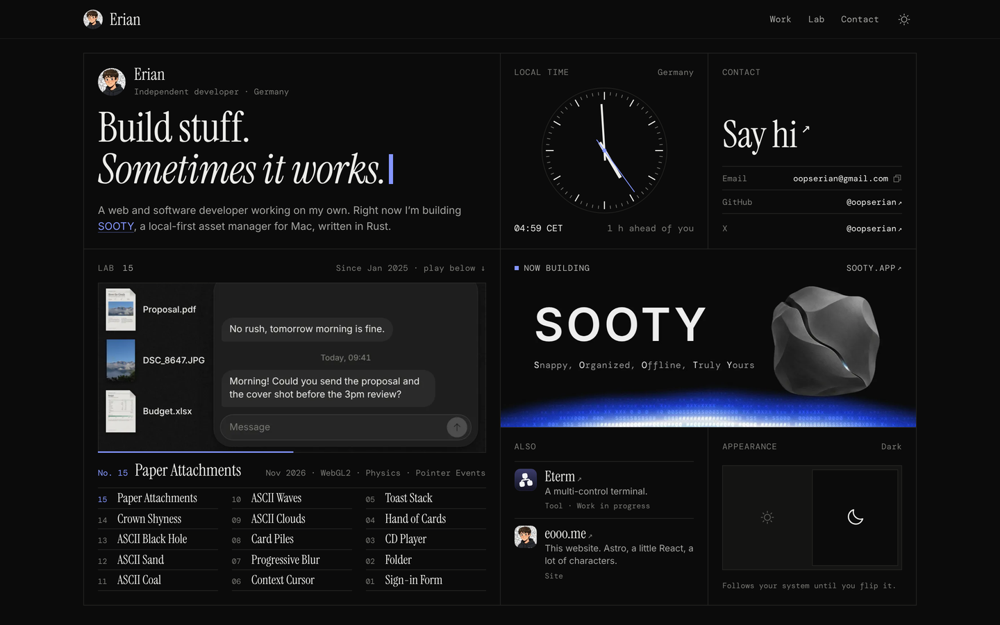

# eooo.me

Erian 的个人网站：首屏是一格一格的一张表，一屏放下简介、德国时间、联系方式、全部实验（预览会自己轮播）、正在做的 SOOTY、别的项目和深浅色开关，往下是一组能直接玩的界面小实验。网站上的字是英文的，代码注释和文档用中文。



## 本地开发

要 Node 22.23.4 以上（Astro 7 的要求，CI 用的是 24）和 pnpm。

```bash
pnpm install
pnpm dev        # http://localhost:4321
pnpm build      # 生成 dist/
pnpm preview    # 看 dist/ 的样子
pnpm check      # 类型检查
```

改完用浏览器在 1440 和 390 两种宽度、浅色深色各看一遍：不能有横向滚动条，控制台不能有报错。

## 目录

| 位置 | 是什么 |
|---|---|
| `src/pages/` | 页面，一个文件一页：首页 `index.astro`、实验详情 `lab/[slug].astro`、`404.astro` |
| `src/layouts/Base.astro` | 每页共用的外壳：`<head>`（标题、描述、分享卡片）、顶栏、页脚 |
| `src/components/` | 顶栏 `Nav`、页脚 `Footer`、首屏 `Hero`（见「首屏」）、往下的实验 `Labs` 和它们用的小组件 |
| `src/site.ts` | 名字、简介、邮箱、GitHub 和 X 的地址，改一处到处跟着变 |
| `src/content/projects/` | 「Projects」里的项目，一个一个 `.md`，字段见 `src/content.config.ts` |
| `src/labs/<slug>/` | 一个实验一个目录：`index.md` 是标题、标签和 prompt，`Demo.tsx` 是组件，样式和图片也放这里 |
| `src/labs/_kit/` | 实验共用的样子（`kit.css`）、图标（`icons.tsx`），见「实验的样子」；WebGL2 的样板（`gl.js`），见「选型」 |
| `src/islands/LabDemo.tsx` | 页面上唯一的 React 入口，把实验挂到舞台上 |
| `tools/portrait.py` | 从头像插画生成小头像和 favicon |
| `tools/og.mjs` | 给每个实验截分享图（`public/og/lab/`）和首屏预览框用的小图（`public/thumb/lab/`），见「分享卡片」 |
| `src/styles/global.css` | 配色、字体、几个到处用的类；各组件的样式写在组件自己的 `<style>` 里 |
| `src/assets/` | 头像（`avatar.webp`，顶栏和项目列表用）、项目图标、SOOTY 的海报这些要经过 Astro 压缩的图 |
| `public/` | 原样发布的文件：字体、favicon、分享卡片 `og.png` 和 `og/lab/`、实验的预览小图 `thumb/lab/`、`CNAME` |

## 加一个实验

1. 建目录 `src/labs/<slug>/`，`slug` 就是网址里那段（`/lab/<slug>/`），用小写和短横线。
2. 写 `Demo.tsx`，默认导出一个 React 组件。根元素写 `className="lab-root <自己的类名>"`：`lab-root` 让它撑满舞台、内容居中，颜色、圆角、阴影都从它上面的变量取（见下面「实验的样子」）。舞台在卡片上高 280px，详情页上撑满第一屏剩下的高度（宽 1440、高 900 的窗口里大约 1200×580，手机上 360×500 上下），底色跟着主题走（浅色是浅灰，深色是深灰）；`index.md` 写了 `dark: true` 的，不管主题都是深灰的底，实验里读到的 `color-scheme` 也是深色，就一直按深色那套画。样式写在同目录的 `style.css`，在 `Demo.tsx` 里 `import "./style.css"`，选择器都挂在自己的类名下面（`.folder-lab .front`），不写裸的 `button`、`p`。图标从 `../_kit/icons` 拿，要用 WebGL2 画的从 `../_kit/gl.js` 拿样板（建上下文、编着色器、离屏图这些）。图片放 `assets/`，引用写 `import cover from "./assets/cover.webp?url"`（带 `?url` 拿到的是地址；不带的话 Astro 给的是一个对象，`` 会变成 `[object Object]`）。
3. 写 `index.md`：

   ```md
   ---
   title: Folder
   summary: 卡片和详情页标题下的一句话
   tags: [CSS, SVG]
   date: 2025-01-08         # 做出来的日子：卡片上显示年月（Jan 2025），详情页显示月份全称
   inspiration: https://…   # 照着谁的设计做的，没有就不写
   wip: true                # 还没做完：卡片上画斜条纹，不挂组件，不生成详情页
   dark: true               # 舞台不管浅色深色都是深底。五个 ASCII 实验都开着：细的字在浅灰底上发虚（2026-11-17）
   order: 5                 # 同一天做的按它排，越小越靠前
   prompt: |-               # 详情页上的 Prompt，英文，分段，保留换行（所以是 |-，不是 >-）
     Add a folder to my project that opens and fans out the photos inside when you point at it. …

     0. Start from what exists
     - Find where the folder goes, …

     1. Shapes and colours
     - …

     4. Done when
     - …
     - You tell me every file you added or changed.
   ---
   ```

   只写头，不写正文：详情页舞台下面只放 Prompt（右上角一个拷贝按钮，超过 360px 高先折起来）和源码地址，不放做法说明（2026-11-04 laken 定的）。

   详情页的第一屏是录屏用的一整块（2026-11-04 laken 要的，方便自己录屏）：标题和一句话在框外，1px 细线框起来的舞台撑满一屏剩下的高度，框下一行左边是日期和标签，右边是 X 上的 @oopserian（水印，也是链接）。右上角「Focus」把这一块铺满整个窗口，藏掉顶栏、页脚和下面的东西，四边留白跟分享图一样；地址加上 `?focus`，Esc 或浏览器的后退回来，直接开 `/lab/<slug>/?focus` 也行。录屏时先换好主题再进整窗模式。

   prompt 是给读者拷进自己项目里用的，不是只复刻我们这个 demo（2026-11-04 laken 定，参考了别人那种分步骤的长 prompt）。照现有几个的样子写：开头一两句说要做什么、用什么做、放进「我」现有的框架和设计系统里；`0. Start from what exists` 先让 AI 看项目里已有的组件和设计变量；中间几段按这个实验的门道分（结构、交互、动效、主题、性能和无障碍）；最后 `Done when` 列做完要满足什么，最后一条是「告诉我改了哪些文件」。数字、曲线、时长都照代码写，写之前对一遍。

卡片上的「源码」链接指向 GitHub 上的 `src/labs/<slug>/`，不用另外填。首页的实验排成两列，新做的在前（按 `date`，同一天的按 `order`，2026-11-05 laken 定），首屏的实验目录、详情页的上一个和下一个也按这个顺序；个数是单数时第一张（最新的）占满一行。加完实验跑一遍 `tools/og.mjs`，截它的分享图和首屏预览框用的小图（见「分享卡片」），没截的话预览框里是一块斜条纹。`index.md` 里的标题、一句话和 prompt 照代码实际怎么做的写，改了做法要跟着改。

## 实验的样子

`src/labs/_kit/kit.css` 是实验共用的一套样子，由 `LabDemo.tsx` 引进来；`_kit/icons.tsx` 是实验用的图标。2026-10-27 laken 要把八个实验的样子统一起来，说明了不是改成直角，于是：

- 网站本身是直角、不用阴影；实验是一个个能摸的小组件，留着圆角和很轻的阴影，但只用这几档：圆角 `--lab-r-sm` 8px、`--lab-r-md` 12px、`--lab-r-lg` 16px、`--lab-r-xl` 24px，阴影 `--lab-shadow-1`（贴着）和 `--lab-shadow-2`（浮起来）。
- 颜色都用 `--lab-*` 变量（卡片底 `--lab-surface`、凹下去的 `--lab-sunken`、线 `--lab-line`、字 `--lab-fg` 这些），用 `light-dark()` 跟着网站的浅色深色走，不写死某一种主题的颜色。强调色就是网站的钴蓝 `--lab-accent`，另外只有报错的 `--lab-danger` 和成功的 `--lab-success`。
- 动效曲线用 `--lab-ease`（一般的过渡）和 `--lab-spring`（弹出来，稍微冲过头）。系统开了「减弱动态效果」，`kit.css` 把实验里的过渡和动画都缩到一瞬。
- 鼠标、触屏、键盘都要能玩：悬停才有的效果，触屏上换成点一下；能点的东西用 `button`，或者加上 `role` 和 `tabIndex`。舞台底下一行 `.lab-hint` 告诉人怎么玩，鼠标、触屏玩法不一样就写两句（`.for-mouse`、`.for-touch`），按设备只露一句。按钮用 `.lab-btn`。
- 省：指针移动时不改 React 的状态，位置写进 CSS 变量或者直接写 `transform`；动的只有 `transform`、`opacity`（和 `translate`、`rotate`、`scale` 这几个单独的属性）；一直转的用 CSS 动画，暂停用 `animation-play-state`；`backdrop-filter` 这种贵的层只在用的时候挂上。
- 不用动画库和图标库：原来几个实验的 Motion 动画换成了 CSS 过渡、`@starting-style` 和 Web Animations，Tabler 图标换成了 Phosphor（跟网站一样），这样实验只下载 React 和自己那一小段。要加图标，从 `@phosphor-icons/core` 的 `assets/regular/` 里把 `<path>` 的 `d` 拷进 `icons.tsx`。不经过 React、由脚本自己建的元素（比如 Paper Attachments 里拖进来才有的附件小图）用同一个文件里的 `iconSvg(name, size)` 拿 SVG 字符串。

## 加一个项目

在 `src/content/projects/` 加一个 `.md`，只要 frontmatter：`name`、`summary`（一行）、`kind`（App、Tool、Site 这种）、`status`（可不写）、`url`、`icon`（`src/assets/` 里的图，写相对路径）、`order`、`hidden`（可不写）。

图标要正方形、铺满不留白（四周透明的边裁掉），列表里一律显示成 40px、圆角 27% 的方块，几个图标才一样大。

## 设计约定

- 直角、不用阴影，区块之间用 1px 细线分开。首页每一节左边是等宽小字的节名，宽屏上跟着滚动停在顶上。
- 黑白灰为主，略带暖。强调色只有一个钴蓝，只给链接、当前状态（比如首屏实验目录里正放着的那一行）和字符画里被搅动的字：浅色主题 `#2F4BE8`（在底色上对比度 6.0），深色主题 `#8597FF`（7.4）。原来是炭火的橙，2026-10-27 laken 嫌它发黄，换成了蓝。灰的几档都过 4.5。值在 `global.css` 开头，深色写了两处（跟随系统、手动选了深色），改要一起改；手动选了深色那一处同时管 `.always-dark`，就是不管主题都用深色的一块（`dark: true` 的实验舞台）。
- 大标题 Instrument Serif（第二行斜体），标签、日期、导航这些小字 DM Mono，正文用系统字体。两款都是 SIL OFL 1.1，许可证在 `public/fonts/OFL.txt`，文件是从 sooty 官网拷来的拉丁字母子集。字体都放在本站，不从 Google Fonts 拿。
- 浅色、深色跟随系统，顶栏右边的按钮可以手动换，记在 `localStorage` 的 `theme` 里；`<head>` 最前面那段脚本在页面画出来之前就定好，不闪。
- 页面上只有淡入和短距离的位移（`.rise`）。一直在动的只有首屏的三样：钟、实验预览框的轮播和标题后面一闪一闪的光标，首屏看不见、标签页在后台时都停。系统开了「减弱动态效果」，淡入、轮播、换图的擦入和光标都不动，钟还走，但秒针不回弹。

## 首屏

2026-11-17 laken 要首屏「一页展示大多数内容」、有设计感，并去掉原来的字符画头像。第一版是「田」字分四块的目录加悬停预览框；laken 拿 xiangyidesign.com 那种一格一格的仪表盘来比，说「不是让你抄，而是学习」，当天改成了现在这样（`src/components/Hero.astro`）。学的是思路：每格放一样有画面的东西，有一两样一直在走，有一处大字，个人信息做成能看的东西，开关做得好玩，格子的做法统一；样子还是本站自己的（直角、1px 细线、衬线大字、一个钴蓝）。原来的 Now、Projects、Contact 三节都收进了首屏，首页往下只剩能玩的实验。字符画头像的代码（`src/scripts/ascii.ts`）和 `portrait.webp` 一起删了，要找回来看 cd9dd64 那一版。

- 版式：一张 4 列 3 行的表，格子之间 1px 的线（`gap: 1px` 露出底色，跟下面实验的网格一个做法）。宽屏上表高是一屏减掉顶栏（最矮 760、最高 920；1280×800 这种矮屏底下会出去三四十像素，再矮格子里就挤了）。第一行：简介（占两格）、钟、联系；第二三行：左边实验占四格，右边上面 SOOTY 占两格，下面其他项目和深浅色开关。每格左上是等宽小字的格名，右上是一句补充。
- 简介：头像、名字、一句身份，大标题「Build stuff. / Sometimes it works.」后面一个一闪一闪的蓝色方块光标，下面一句介绍。标题字号跟着屏幕高度在 40–46 之间变（`clamp(40px, 5.2svh, 46px)`），矮屏上头像那行和标题不挤。
- 钟：德国时间（`Europe/Berlin`），每秒走一下，秒针是蓝的，跳的时候稍微冲过头再回来（像车站的钟）；秒针一直往前转，不从 59 倒回 0。底下写现在几点和跟看的人差几个小时（「Same time as you」「1 h ahead of you」）。
- 联系：大字「Say hi ↗」是 mailto，下面邮箱（点了复制，右边的小图标变成勾；剪贴板用不了就打开邮件）、GitHub、X。
- 实验：上面一个预览框，下面一行是编号、名字、年月和标签，再下面是全部实验的目录（新的在前，编号按做出来的先后，最早的是 01，新加实验不会改动旧实验的号；宽屏分三列，手机上只列最新五个，最后一行「+N More below」跳到下面的实验）。预览框自己轮播：底边一道蓝线 5 秒从左走到右，走完换下一个；换的时候新图从上往下擦进来（往回指就从下往上，`clip-path`），里面的图从 1.06 倍缩回原大，被盖住的那张顺着方向让开一点，下面那行淡入。指到目录里的哪个（键盘 Tab 到也一样）就换成哪个，正放着的那一行编号是蓝的。指针在这一格上、键盘焦点在这一格里、开了「减弱动态效果」时不轮播（减弱动态效果时换图也不擦，直接换）。预览框是鼠标的便利，内容跟目录重复，读屏和 Tab 跳过它（`aria-hidden`、`tabindex="-1"`）。
- 图：实验的是 `public/thumb/lab/<slug>-light.webp`、`-dark.webp`，`tools/og.mjs` 截的（只有舞台、不带字），按当前主题挑，换主题时当前那张跟着换。轮播时先把下一张拿下来，指针第一次进目录时把当前主题的都拿下来。还没截的实验放斜条纹。
- SOOTY：海报铺满，左上「Now building」前面一个蓝色小方块，右上 sooty.app；指上去海报轻轻放大，底下露出四个小标签（Rust + GPUI 这些），触屏上不露（一直露着会挡住海报）。其他项目里就不再列一遍 SOOTY。
- 深浅色开关：一个方的大开关，浅色时方块在左（太阳），深色在右（月亮），点了整站换主题。跟顶栏的按钮是同一个设置（`localStorage` 的 `theme`），哪边换了另一边都跟着变。
- 窄屏：1080 以下两列，简介、SOOTY、实验各占一行，下面钟和联系、项目和开关两两并排；640 以下简介、SOOTY、实验、联系各占一行，钟和开关并排，项目在最后。
- 省：首屏没有 React，只有一段小脚本（钟、轮播、复制、开关）；钟和轮播只在首屏看得见、标签页在前台时走。

## 选型

- **Astro**（静态生成）：比较过留在 Vite + React 单页、Next.js 静态导出、Eleventy。原来的单页把所有东西都放在一个 JS 里，HTML 是空的，搜索引擎和分享卡片都看不到内容，首屏要等 React 下载完；Next.js 静态导出每页都带着 React 的运行时；Eleventy 页面很轻，但实验是 React 组件，要另想办法挂。Astro 默认页面不带 JS，又能把 React 组件当「岛」按需挂，正好：首页本身只有主题按钮和首屏两段小脚本，React 和实验的代码等滚到实验那一节才下载，一个实验一个文件。sooty 的官网也是 Astro，用法一样。
- **React 只给实验用**：实验原来就是 React 写的，拖动、切换这些交互用 React 写也顺手，源码公开给人看。2026-10-27 重写时样式换成了普通 CSS 和共用的 `_kit/kit.css`，去掉了 Motion、Tabler 图标和 Tailwind 的类名（见「实验的样子」）。网站本身（顶栏、首页、详情页）全是 Astro 组件和普通 CSS。
- **Tailwind 只扫 `src/labs/`**：现在的实验都不用它的类名，留着主要是 preflight 当整站的样式重置；以后的实验想用类名也能用。网站自己的样式不用 Tailwind，写在组件的 `<style>` 里。
- **ASCII Waves、ASCII Clouds、ASCII Coal、ASCII Sand、ASCII Black Hole 直接写 WebGL2，不引 3D 库**：五个实验都是着色器在离屏图里画一个真的 3D 场景当底稿（海：透视镜头、12 万个点的海面网格、深度；云：往天上打光线，在云层里一步步走；煤：斜着往下看一床煤块，按 Voronoi 分成一块块，每块的高度连同坡度一起算，光线步进只在尺寸变了时算一次、存下落点，每帧只重新打光，2026-11-05 照 laken 给的一块裂开的煤的图加的；沙：站在沙丘上往地平线看，每个像素往高度场打光线，迎风坡缓、背风坡陡，迎风坡上有沙纹，低低的太阳往太阳那边走几步算影子，2026-11-06 加的；黑洞：每个像素的光线按史瓦西黑洞的引力一步步弯着走，穿过吸积盘就加上盘在那儿的光，盘后面那一半被弯到黑洞上下成两道光环，2026-11-09 laken 要一个宇宙题材的，挑了黑洞），再全屏挑字，屏上只有字。五个实验挑字的做法一样：- ~ = 这类横的字转到浪头、沙纹、煤面等高线、气体绕着转的走向上，明暗主要靠颜色。格子 5px 见方，横的字连描边一起拉到正好一格宽，左右两格首尾相接连成一整道（原来是 8px、拉到八成多宽，一段段断开的；2026-11-17 laken 嫌浅色背景上看不清，要格子密一点、铺满，6px 和 5px 比过以后选了 5px）。黑洞的光线是弯的，字的方向没法从盘面直接投到屏幕上，改成按屏幕上「穿过盘面那一点的半径」的导数算，绕到黑洞上面的光环上字也跟着绕。煤和沙第一版是正对着、从正上方看的，缝和棱用不转的 ~ - \ | / 描（老式字符画的做法），laken 觉得跟海和云比差太多，2026-11-06 都改成了现在的透视镜头和转着的字。2026-11-04 先用 Three.js 写了海浪（laken 定的「全程用 Three.js 和 shader 实时渲染」），同一天做云的时候 laken 觉得不用 Three.js 也能一模一样，定了两个实验都改成原生 WebGL2。着色器本来就是自己写的，Three.js 只替我们做了镜头矩阵、离屏图、深度、mipmap 和「鼠标落在海面哪里」，这些在 `src/labs/_kit/gl.js`（建上下文、编着色器、按类型设 uniform、全屏三角形、离屏图、从 canvas 建贴图）和 `waves.js` 开头的两个矩阵函数里，一共一百多行。改完以后海浪的静止帧跟 Three.js 那版逐像素一样（深浅两种主题、1 倍和 2 倍屏都比过），海浪这个实验少下 540 KB（gzip 后 135 KB）。也看过：
  - Three.js（0.186，MIT）：`PerspectiveCamera`、`RawShaderMaterial`、`WebGLRenderTarget`、`Raycaster` 正好都有，但只用到这几样，场景树、材质、灯光这些大半的代码用不上，却要整个下载。
  - OGL（1.0，Unlicense）：小，接口跟 Three.js 像，但 2025 年初以后没再发版。
  - regl（2.1，MIT）：函数式的写法很省，但只支持 WebGL1，着色器得改写成 GLSL 1.0，2024 年以后没再发版。
- **Crown Shyness 用 CPU 一个像素一个像素地画，不用 WebGL**：画面就是一张约 3.6 万个像素的小图（放大几倍按舞台面积定），再整数倍放大；每个像素要知道归哪棵树、离缝多远、被哪一团叶子盖住、落在色带的哪一档，在 JS 里扫几遍数组最直接，颜色也能一档一档地管住（像素画靠的就是这个）。写成着色器的话，叶团、主枝、近处的叶团这种按先后叠的东西得拆成好几遍渲染，省不了多少。无头 Chromium 里（没有显卡）一帧二十毫秒上下，平时限 30 帧，滚出屏幕就停。2026-11-12 先做成发帖用的单页（照 laken 给的一张林冠照片，像素风参考 feralui.dev/pixel-play），11-13 放进 lab 时把「按宽度排林子、一行一百八十像素」改成按面积：详情页的舞台又宽又矮，按宽度排的话树冠被放得很大、像素也粗。
- **Paper Attachments 直接写 WebGL2，纸的物理在 CPU 上算，不引 Three.js 和物理库**：拿起来的纸是一张 13 列的网格，用 Verlet 积分加距离约束（相邻、对角，再加隔 2、4、8 格的长约束给它纸的硬度），每步再做一次形状匹配，弯得宽而顺、不会在一行上折死；手捏住的是纸宽 17% 的一小块圆，手每步带着纸走七成，快速一甩会摆，但不会皱成一团。一张纸两百来个点（提案是 13 × 18），无头 Chromium 里一帧（两步）算半毫秒左右，写成着色器反而要来回倒数据。画的部分是透视镜头、一张带法线和折角的网格、一张离屏影子图（主光影子按高度往右下滑、贴着纸的环境影子，横竖各模糊一遍），杂活还是 `_kit/gl.js` 那几样，透视矩阵自己写。2026-11-16 先做成发帖用的单页，那一版用的是 Three.js（r128）；放进 lab 时改成原生 WebGL2，省掉这一个实验要下的 Three.js。桌上的小图、附件、发出去的页都是普通的 DOM，只有纸在空中时画布才画，落定了就停；没有 WebGL2 时换成扁平的卡片走同样的路线。
- **分享图用 Playwright 截**（1.63，Apache-2.0，只是开发时用的依赖，不进页面）：实验的样子就是页面本身，截真页面最准，也不用另写一套画图的代码。比较过 Satori（Vercel 的 JSX 转 SVG，MIT）：画标题和字很方便，但画不了实验本身（WebGL、CSS 3D、背景模糊都不支持），只能放一张事先截好的图进去，等于还是要截图；Astro 的 `astro:assets` 只能处理已有的图，不能截图。
- **图标**：Phosphor 的 regular 粗细，几个用到的直接写成内联 SVG（网站的在 `components/Icon.astro`，实验的在 `src/labs/_kit/icons.tsx`），不引图标库。

## 部署

推到 `main` 以后 `.github/workflows/deploy.yml` 用 Node 24 和 pnpm 构建，把 `dist/` 发到 `gh-pages` 分支，GitHub Pages 从那个分支发布到 eooo.me（`public/CNAME`）。`public/.nojekyll` 让 GitHub Pages 不走 Jekyll，不然 `_astro/` 这种下划线开头的目录会被丢掉。

## 分享卡片

`public/og.png` 是首页首屏深色主题 1200×630 的截图（`pnpm build && pnpm preview` 以后，用 Playwright 开 1200×630 的窗口、`colorScheme: 'dark'`、`deviceScaleFactor: 2`，等开场的淡入走完再截，再缩回 1200×630，字和细线才不糊）。改了首屏要重截一张。README 开头的 `docs/home.png` 也是这样截的，窗口 1440×900。

每个实验页有自己的分享图 `public/og/lab/<slug>.png`（2026-11-04 加的，链接贴到 X、微信时显示这个实验，不再都是首页那张）：上面是实验的标题和一句话，下面是 1px 细线框起来的舞台，右下角写 eooo.me，深色，1200×630。`tools/og.mjs` 截：

```bash
pnpm exec playwright install chromium   # 第一次
pnpm build && node tools/og.mjs         # 全部；node tools/og.mjs ascii-clouds 只截这一个
                                        # 加 --og 只截分享图，加 --thumbs 只截首屏预览框的小图
pnpm build                              # 再构建一次，详情页和首屏才用上新图
```

它开详情页的整窗模式（`?focus`），再加一段样式调成卡片（底下那行日期和 @oopserian 换成右下角的 eooo.me，小组件放大 1.25 倍，字符画不放大），按 2 倍画、1 倍截。详情页有这张图就用，没有就用 `og.png`。

同一个脚本接着截首屏预览框用的小图（2026-11-17 加的，见「首屏」）：还是整窗模式，藏掉标题和底下那行，窗口就是舞台，534×280（跟首页卡片上的舞台一样高）按 2 倍截，浅色深色各一张，在浏览器里用 canvas 转成 WebP（质量 0.8，不用另装 sharp），放 `public/thumb/lab/<slug>-light.webp`、`-dark.webp`，十几 KB 到一百多 KB 一张（字符画的几个最大）。

加了实验、改了标题、一句话或者样子，两样都要重截。
